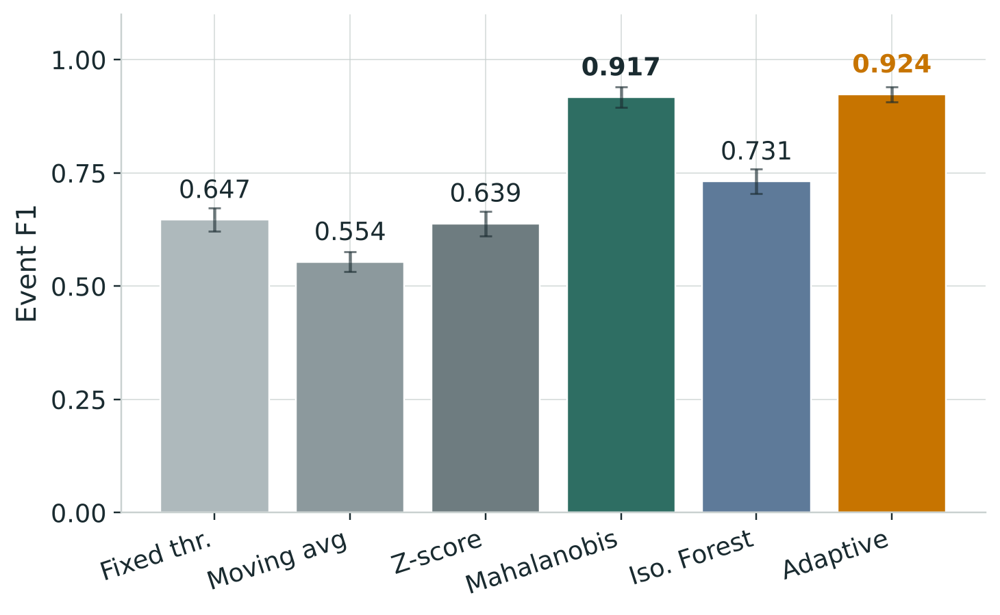
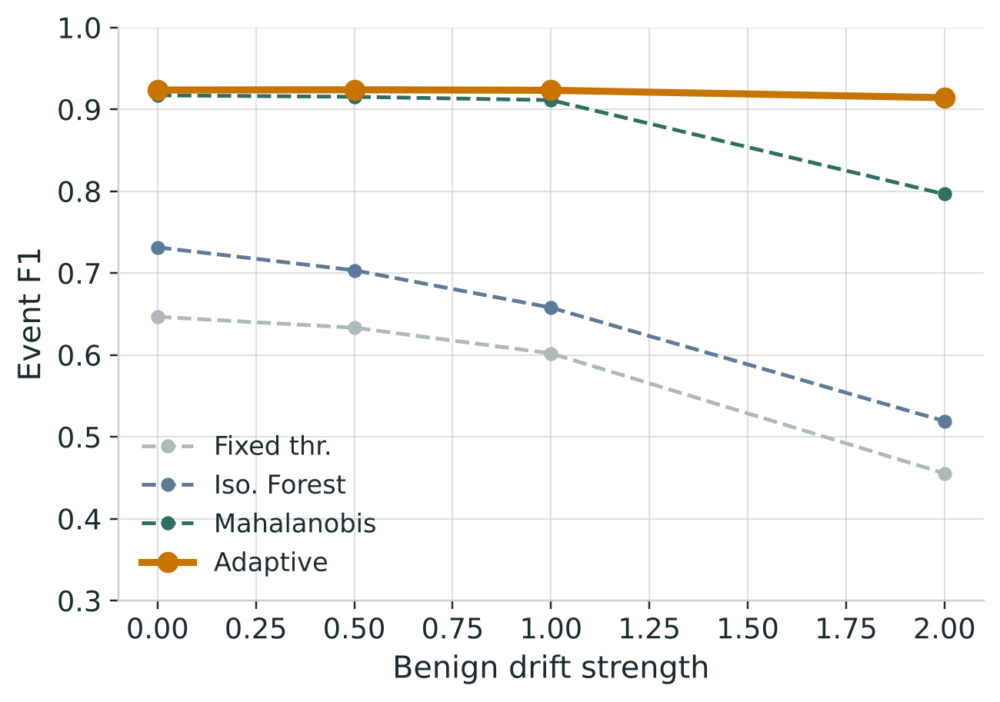
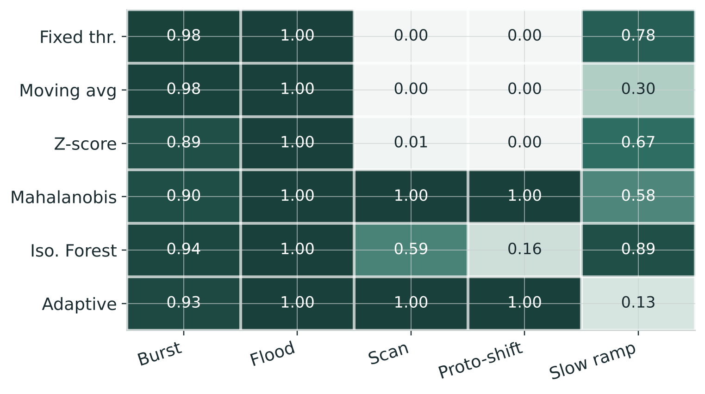
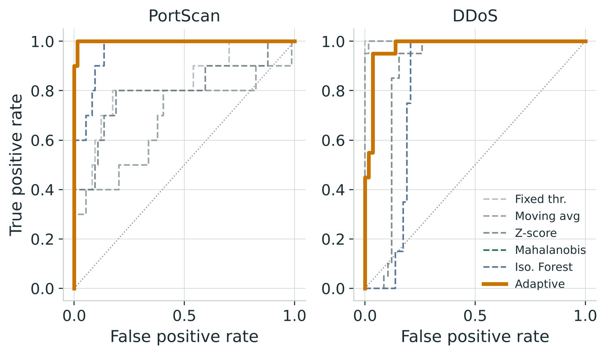

# Adaptive Network Traffic Anomaly Detection

**Lightweight online statistical detection of network anomalies — catching the attacks that volume monitors miss, and staying robust when normal traffic drifts.**

Course-end research mini-project for **Computer Networks (22ITC10N)**, Dept. of Artificial Intelligence & Data Science, Chaitanya Bharathi Institute of Technology (CBIT), Hyderabad.

| | |
|---|---|
| **Team** | A. Hannish Reddi (160124771097), B. Keshav (160124771099), E. Sai Mohan (160124771107) |
| **Paper** | [`report/paper.pdf`](report/paper.pdf) — research paper (12-section format) |
| **Slides** | [`report/CN_AnomalyDetection_Presentation.pptx`](report/CN_AnomalyDetection_Presentation.pptx) |
| **Data** | CIC-IDS2017 (downloaded separately — see [Dataset](#dataset)) |

---

## The question

Can a **training-free statistical detector** catch the anomalies that single-feature volume monitors miss, keep false alarms low, and stay accurate when normal traffic **drifts** — at a cost light enough to run continuously?

## The answer, in one line

**Multi-feature statistical scoring** is what defeats non-volumetric attacks (port scans, protocol shifts) — in simulation *and* on real traffic. **Online adaptation** on top of it ties the static baseline when traffic is stationary and **wins when traffic drifts**, which is the realistic case for a monitor left running for days. No training; 72 floating-point numbers of state.

---

## Headline results

Six detectors are compared: four conventional baselines (fixed threshold, moving average, z-score, static Mahalanobis), one heavy-ML reference (Isolation Forest), and the proposed online **Adaptive** detector. All figures below are generated from the result CSVs in [`results/`](results/).

**Mixed anomalies, 30 held-out simulated traces** — the two multivariate detectors clear every single-feature baseline by a wide, significant margin:



**Robustness to drifting traffic** — as benign traffic drifts, the static detectors degrade while the proposed online detector holds (+0.118 event F1 over the best static baseline at the strongest drift, Wilcoxon p = 0.002):



**Per-attack-type recall** — scans and protocol shifts are caught *only* by the multivariate detectors; slow ramps are the proposed detector's weak point:



**Real data (CIC-IDS2017)** — the simulated finding reappears: multivariate scoring catches the non-volumetric port scan that volume monitors miss (ROC-AUC 0.999, recall 1.0 vs 0.4). DDoS is an easy volumetric case for everyone:



| Detector | Event F1 (mixed) | PortScan ROC-AUC | DDoS ROC-AUC |
|---|---:|---:|---:|
| Fixed threshold | 0.647 | 0.83 | 1.00 |
| Moving average | 0.554 | 0.68 | 1.00 |
| Z-score (static) | 0.639 | 0.80 | 0.87 |
| Mahalanobis (static) | 0.917 | 0.999 | 0.98 |
| Isolation Forest | 0.731 | 0.96 | 0.82 |
| **Adaptive (proposed)** | **0.924** | **0.999** | **0.98** |

---

## Method

Traffic is summarised as a sequence of fixed-length **time windows**, each reduced to an 8-dimensional feature vector: logs of packets, bytes, unique destination ports and unique source IPs; the SYN ratio and UDP fraction; and two ratio features — log packets-per-source and log bytes-per-packet. The ratio features are what expose non-volumetric attacks.

The **proposed detector** maintains an online (EWMA) estimate of the mean `m` and covariance `S` of that vector and scores each window by its normalised Mahalanobis distance:

```
s_t = sqrt( (x_t - m)^T  S^-1  (x_t - m) / p )
```

The update is **gated**: when a window looks suspicious the mean only creeps and the covariance freezes, so an attack cannot be absorbed into the model of "normal". The detector needs no training phase and keeps `O(p^2)` = 72 floats of state (~167× less than the Isolation Forest), at ~33 µs/window.

The same window → feature → detector pipeline runs on both the simulator and the real CIC-IDS2017 flows, so the two are directly comparable.

---

## Repository layout

```
.
├── src/
│   ├── traffic_sim.py      # window-level traffic simulator (5 anomaly families + benign bursts + drift)
│   ├── detectors.py        # 6 detectors + alarm post-processing (persistence, CUSUM)
│   ├── metrics.py          # window- and event-level metrics, confidence intervals
│   ├── experiments.py      # shared harness: scoring, threshold tuning, seed protocol
│   ├── run_main.py         # main comparison (per-anomaly + mixed)
│   ├── run_sweeps.py       # drift / intensity / noise / flash-crowd-rate sweeps
│   ├── tune_adaptive.py    # chooses the adaptive detector's hyper-parameters on dev seeds
│   ├── run_final.py        # FINAL held-out evaluation (seeds 2000-2029) + Wilcoxon tests
│   ├── ablation.py         # ablation of the proposed components + per-window overhead
│   ├── analyze.py          # summary tables + paired Wilcoxon (Holm-corrected)
│   ├── make_figures.py     # paper figures (vector PDF)
│   ├── cic_pipeline.py     # CIC-IDS2017 flow CSVs -> per-minute window features
│   └── cic_eval.py         # evaluate the frozen detectors on CIC-IDS2017
├── tests/test_core.py      # 14 unit tests (determinism, causality, metrics, alarms, drift)
├── results/                # all result CSV/JSON (sweeps, final, ablation, overhead, CIC)
├── report/
│   ├── paper.pdf / paper.tex        # the research paper
│   ├── figures/                     # paper figures (PDF)
│   ├── deck_assets/ + make_deck_assets.py   # deck-styled figures
│   ├── make_deck.js                 # presentation generator (pptxgenjs)
│   └── CN_AnomalyDetection_Presentation.pptx
├── data/raw/               # CIC-IDS2017 goes here (not tracked — see Dataset)
├── data/processed/         # windowed real-data feature tables (small, tracked)
└── requirements.txt
```

---

## Reproduce

```bash
pip install -r requirements.txt

python -m unittest discover -s tests -t .   # 14 tests should pass

python -m src.tune_adaptive                 # dev-seed hyper-parameter choice
python -m src.run_main                       # main comparison      -> results/summary_main.csv
python -m src.run_sweeps                     # sweeps              -> results/sweeps*.csv
python -m src.ablation                       # ablation + overhead -> results/ablation.csv, overhead.csv
python -m src.run_final                      # final held-out run  -> results/final_*.csv

# figures
python -m src.make_figures                   # paper figures -> report/figures/*.pdf
python -m report.make_deck_assets            # deck figures  -> report/deck_assets/*.png
```

**Reproducibility / seed protocol.** Hyper-parameters and alarm thresholds are tuned only on development seeds (100–109). Debug seeds (0–29) were used while building and are never reported. The headline numbers come from a **final held-out set (seeds 2000–2029)** that the method never saw during development. On real data the method is frozen; only the alarm threshold is calibrated on a benign period.

---

## Dataset

The real-data experiments use **CIC-IDS2017** (Canadian Institute for Cybersecurity). The dataset is **not** stored in this repository (the labelled-flow archive is ~270 MB, over GitHub's file-size limit).

1. Download the **labelled flow CSVs** — the `GeneratedLabelledFlows.zip` archive (the *TrafficLabelling* version, which keeps timestamps, IPs and ports) from the CIC-IDS2017 dataset page:
   <https://www.unb.ca/cic/datasets/ids-2017.html>
2. Place the archive at `data/raw/GeneratedLabelledFlows.zip`. Expected MD5:
   ```
   5ca3f8f69e3514950681615824149973  GeneratedLabelledFlows.zip
   ```
3. The pipeline reads the Friday port-scan and DDoS captures from inside the archive. The processed per-minute window tables are already included under `data/processed/` for convenience.

> Do **not** use the `MachineLearningCSV` version — it drops the timestamps and IPs needed to build time windows.

---

## Limitations

The controlled experiments use synthetic traffic, so absolute numbers reflect the generative assumptions rather than any specific production network; real-data validation mitigates this but is itself limited. The CIC-IDS2017 captures are single, hour-long sessions with minute-resolution timestamps, so they are too short and too stationary to demonstrate the drift advantage on real traffic. The detector also trails on very slow-ramping attacks, because its own adaptation partly absorbs a gradual change. See the paper's Limitations section for details.

---

## Citation / references

- I. Sharafaldin, A. H. Lashkari, A. A. Ghorbani. *Toward Generating a New Intrusion Detection Dataset and Intrusion Traffic Characterization.* ICISSP 2018. (CIC-IDS2017)
- F. T. Liu, K. M. Ting, Z.-H. Zhou. *Isolation Forest.* ICDM 2008.
- S. W. Roberts. *Control chart tests based on geometric moving averages.* Technometrics, 1959. (EWMA)

## License

Released under the MIT License — see [`LICENSE`](LICENSE).
